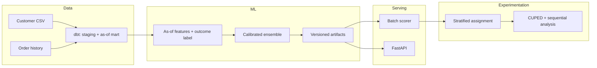

# Retention Intelligence

**Churn prediction, calibrated risk scoring, A/B experimentation, and a prototype agentic re-engagement layer for e-commerce.**

[](https://github.com/koraysrn/retention-intelligence/actions/workflows/ci.yml)
[](https://www.python.org/)
[](https://www.getdbt.com/)
[](#scope-and-limitations)

Retention Intelligence is an end-to-end reference implementation for identifying customers at risk of churning, prioritising retention actions, and measuring campaign impact with a statistically defensible experiment design. It combines a leakage-free as-of feature pipeline, a calibrated gradient-boosting ensemble, a FastAPI serving layer, a dbt mart, and an A/B analysis toolkit.

> This is a **portfolio prototype**, not a production SaaS platform. The core churn, experimentation, and serving paths are implemented and tested; platform integrations that require external infrastructure are explicitly out of scope. See [Scope and limitations](#scope-and-limitations).

---

## Table of contents

- [Overview](#overview)
- [Key capabilities](#key-capabilities)
- [Architecture](#architecture)
- [Tech stack](#tech-stack)
- [Quick start](#quick-start)
- [Usage](#usage)
- [Model and evaluation](#model-and-evaluation)
- [Experimentation](#experimentation)
- [Project structure](#project-structure)
- [Documentation](#documentation)
- [Scope and limitations](#scope-and-limitations)
- [Security](#security)
- [License](#license)

---

## Overview

E-commerce retention teams need to answer three questions:

1. **Who is likely to churn?** — score customers with a model trained on data available *before* the outcome window.
2. **Who should we contact, and with what?** — turn calibrated probabilities into risk tiers, profit-aware thresholds, and consent-safe actions.
3. **Did the campaign work?** — run a stratified experiment and analyse churn, net revenue, guardrails, and sequential stopping rules.

Retention Intelligence implements this workflow on a committed synthetic dataset that follows the production 27-column customer schema and includes a transaction-level order history. The same code can point at a licensed real dataset via `DATA_URL`.

### Design principles

- **No future leakage.** Features use only observations at or before `as_of_date`; the label uses only the outcome window `(as_of, as_of + 90 days]`.
- **Calibrated, not just ranked.** Probabilities are checked with Brier score, log loss, reliability curves, and calibration slope.
- **Business-aware thresholds.** The operating threshold comes from a profit curve parameterised by LTV, incentive cost, and expected uplift.
- **Safe actions.** Coupon delivery requires confirmation, marketing consent, a budget/recipient cap, and an idempotency key.
- **Auditable experiments.** Stratified assignment, SRM, covariate balance, CUPED, sequential testing, and a documented decision rule.

---

## Key capabilities

| Area | What it provides |
|---|---|
| **As-of feature engineering** | Customer snapshot at a configurable cutoff; order history is used when available; pre-cutoff session/purchase features; JSON metadata artifact |
| **Churn label** | `churn = 1` iff no purchase in the 90-day outcome window; zero-order, one-time, and repeat segments are reported separately |
| **Leakage controls** | `total_orders`, spend/AOV/CLV, order-profile categories, PII, and label/audit columns never enter the model; recency ablation is reported |
| **Model** | LightGBM + XGBoost + CatBoost/HistGradientBoosting soft-voting ensemble, cross-fitted Platt calibration |
| **Evaluation** | PR-AUC/ROC-AUC with bootstrap CI, Brier, log loss, ECE, reliability curve, calibration slope/intercept, lift, profit curve |
| **Serving** | `serving_config.json` contract, batch scoring, FastAPI online scoring, model-version traceability |
| **Retraining** | Validation gate (PR-AUC/Brier/calibration), versioned artifacts, atomic `current` promotion |
| **Experimentation** | Stratified block randomisation, SRM chi-square, SMD balance, CUPED, O'Brien-Fleming/Lan-DeMets, Holm correction, decision rule |
| **Data quality** | dbt staging/mart models, unique/not_null/accepted_values/relationships tests, Python↔dbt parity test |
| **Security** | API-key auth with admin/read roles, PII masking, prompt-injection guard, confirmation-gated actions, audit log |

---

## Architecture



The dbt mart and the Python feature builder implement the same as-of contract; a parity test verifies every feature and label.

---

## Tech stack

| Layer | Tools |
|---|---|
| Language | Python 3.15 |
| Data | pandas, NumPy, PyArrow, DuckDB |
| Transformation | dbt-core + dbt-duckdb |
| ML | scikit-learn, LightGBM, XGBoost, SHAP |
| Serving | FastAPI, Uvicorn |
| Experimentation | SciPy, statsmodels |
| Tracking | MLflow (optional, fast fallback) |
| Quality | pytest, ruff, mypy |

> **CatBoost note:** CatBoost does not currently publish a Python 3.15 wheel. The ensemble keeps three members by using scikit-learn `HistGradientBoostingClassifier` as the third model when CatBoost is unavailable. `metrics.json` records the actual member list.

---

## Quick start

### Prerequisites

- Linux/macOS shell with `curl` and `make`
- No system conda installation required; `make setup` bootstraps a local `micromamba`

### Setup

```bash
git clone https://github.com/koraysrn/retention-intelligence.git
cd retention-intelligence

make setup      # create the Python 3.15 env, install extras, copy dbt profile/.env
make data       # materialize the committed synthetic dataset
make pipeline   # quality -> ingest -> dbt build -> features -> train -> score -> A/B
make test       # unit, leakage, parity, security, and e2e tests
```

### Serve the API

```bash
make run-api
# http://127.0.0.1:8010
```

Development API keys come from `.env.example`:

| Role | Header | Default |
|---|---|---|
| Admin | `X-API-Key` | `dev-admin-key` |
| Read-only | `X-API-Key` | `dev-read-key` |

Replace these values outside a local prototype.

---

## Usage

### Run the full pipeline

```bash
make pipeline
```

Optional cutoff and horizon:

```bash
make pipeline AS_OF=2025-10-02 HORIZON=90
```

### Train and score

```bash
make train
make score
```

The model is written to `artifacts/model_ecommerce_ensemble/` with:

```text
pipeline.joblib
metrics.json
serving_config.json
shap_importance.csv
explanations.json
versions/<model_version>/
current -> versions/<model_version>
```

### Query the API

```bash
# Summary
curl -H "X-API-Key: dev-admin-key" http://127.0.0.1:8010/api/summary

# Customer profile (read key masks PII)
curl -H "X-API-Key: dev-read-key" http://127.0.0.1:8010/api/customers/1000

# Online score
curl -X POST http://127.0.0.1:8010/predict \
  -H "X-API-Key: dev-admin-key" \
  -H "Content-Type: application/json" \
  -d '{"customer_id":"1000","features":{...}}'
```

### Run the A/B analysis

```bash
make ab-experiment
```

The report is written to `artifacts/ab_experiment_report.json` and is always marked `"simulated": true`.

### Quality gates

```bash
make lint
make typecheck
make test
```

---

## Model and evaluation

### Label definition

```text
as_of_date: observation cutoff
observation window: t <= as_of_date
outcome window: as_of_date < t <= as_of_date + 90 days

churn = 1 iff there is no purchase in the outcome window
```

Full definition: [`docs/churn_definition.md`](docs/churn_definition.md).

### Evaluation protocol

- Stratified 80/20 holdout
- Stratified K-fold cross-validation on the training portion
- Cross-fitted Platt calibration on out-of-fold scores
- Holdout metrics: PR-AUC/ROC-AUC with bootstrap 95% CI, Brier, log loss, ECE, reliability curve, calibration slope/intercept
- Profit-aware threshold selection using configurable LTV, incentive cost, and uplift
- SHAP global importance plus per-customer top-3 drivers

### Fixture results

The committed fixture is synthetic: 1,200 customers, 3,251 orders, seed 42, CC0-1.0. It is intended to exercise the pipeline, not to claim real-world performance.

| Metric | Value |
|---|---|
| PR-AUC | **0.726** (95% CI 0.656–0.792) |
| Naive baseline PR-AUC | 0.588 |
| ROC-AUC | 0.672 (95% CI 0.599–0.729) |
| Brier score | 0.223 |
| Log loss | 0.638 |
| Calibration slope | 0.742 |
| Serving threshold | 0.257 |
| PR-AUC with / without recency | 0.718 / **0.716** |
| Recency ablation verdict | `no_material_recency_leakage` |

The exact numbers are regenerated on every run in `artifacts/model_ecommerce_ensemble/metrics.json`.

---

## Experimentation

The experimentation module provides:

- **Stratified block randomisation** by country, spend decile, and tenure bucket
- **SRM** chi-square check
- **Covariate balance** via standardised mean difference (SMD)
- **CUPED** variance reduction with control-weighted θ
- **Sequential testing** with O'Brien-Fleming boundaries and Lan-DeMets alpha spending
- **Guardrails** for unsubscribe and complaint rates
- **Holm correction** for multiple metrics
- **Decision rule** requiring statistical and practical significance, plus revenue non-inferiority

The report includes `decision_inputs` so the outcome is auditable.

---

## Project structure

```text
.
├── configs/                 # thresholds, LTV, uplift, serving ports
├── data/fixtures/           # committed synthetic customer + order fixtures
├── dbt/
│   └── models/              # staging + as-of mart models and tests
├── docs/                    # label, metrics, data dictionary, model card, ADRs
├── experimental/            # reserved for non-production work
├── frontend/                # React + Vite dashboard
├── scripts/                 # bootstrap, data, features, training, pipeline, A/B
├── src/
│   ├── agents/              # prototype RAG/agent layer (not production)
│   ├── data/                # loading, ingestion, quality checks
│   ├── experiments/         # assignment, CUPED, sequential analysis
│   ├── features/            # as-of feature engineering and churn label
│   ├── models/              # evaluation, calibration, ensemble
│   ├── monitoring/          # drift, retraining gate, promotion
│   ├── serving/             # FastAPI and batch scoring
│   └── utils/               # shared utilities
├── tests/                   # unit, leakage, parity, security, e2e, quality
├── environment.yml          # Python 3.15 environment
├── Makefile                 # setup / data / pipeline / test / demo
└── pyproject.toml           # dependencies and tool configuration
```

---

## Documentation

| Document | Description |
|---|---|
| [`docs/churn_definition.md`](docs/churn_definition.md) | As-of/outcome label and leakage rules |
| [`docs/metrics.md`](docs/metrics.md) | Metric protocol, profit formula, risk tiers |
| [`docs/data_dictionary.md`](docs/data_dictionary.md) | Schema, provenance, and data limitations |
| [`docs/model_card.md`](docs/model_card.md) | Intended use, out-of-scope use, segments, ethics, retraining |
| [`docs/ab_test_design.md`](docs/ab_test_design.md) | Assignment, CUPED, sequential testing, decision rule |
| [`docs/architecture.md`](docs/architecture.md) | System architecture |
| [`docs/agentic_ai_design.md`](docs/agentic_ai_design.md) | Agent/RAG design prototype |
| [`docs/adr/`](docs/adr/) | Architecture decision records |

---

## Scope and limitations

### Prototype components

- **RAG/agent layer:** keyword-overlap retrieval over four documents; no pgvector, embeddings, reranker, citations, or retrieval evaluation. Explicitly excluded from the default pipeline.
- **LLM:** provider abstraction with a deterministic mock; no production prompt-evaluation pipeline.
- **A/B outcomes:** simulated (`simulated: true`). Assignment and analysis are real.
- **MLflow:** optional; local versioned artifacts are authoritative.
- **Feature store:** local parquet/DuckDB; no Feast integration.

### Not implemented

- Kafka or real-time streaming ingestion
- Feast feature store
- GrowthBook/Statsig
- Real pgvector embeddings, hybrid search, reranker, citation-grounded RAG
- Enterprise RBAC/SSO, secret manager, PII vault
- True uplift modelling / Qini curves
- Production alerting and on-call runbooks

### Data limitations

- The committed fixture is synthetic and illustrative.
- Order-derived features are fully as-of when the order history is present.
- `total_sessions` and `avg_rating_given` are lifetime aggregates in the 27-column export; a production build should add a session-event table for a fully as-of snapshot.

---

## Security

- API endpoints require `X-API-Key`.
- Read-only keys receive masked PII.
- Chat blocks prompt-injection patterns.
- Coupon actions require explicit `confirm=true`, marketing consent, budget/recipient caps, and an idempotency key.
- Actions are appended to `artifacts/action_audit.jsonl`.

Report vulnerabilities according to [`SECURITY.md`](SECURITY.md).

---

## License

Proprietary. See [`pyproject.toml`](pyproject.toml) for the project metadata. The synthetic fixtures are CC0-1.0 and contain no real customer records.
